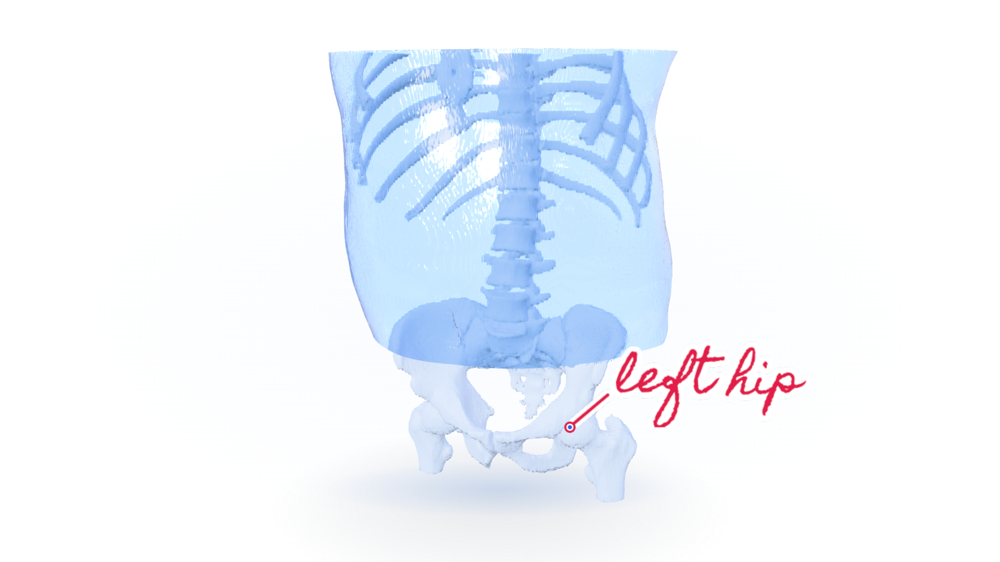
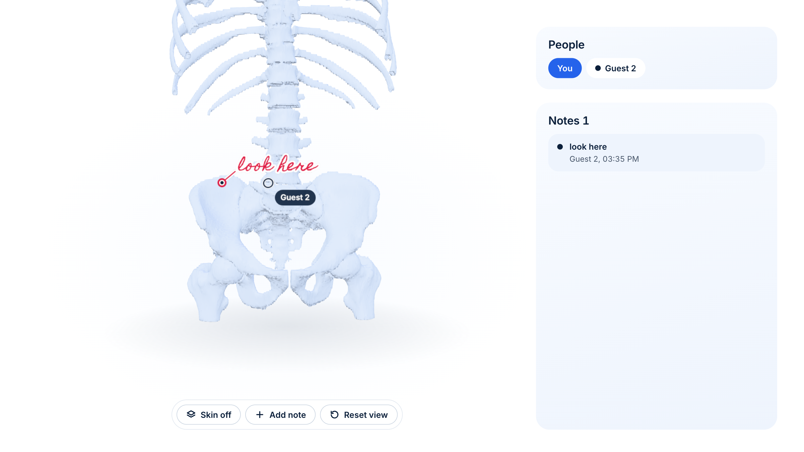

# AR surgical planning

Turn a CT scan into 3D models of bone and skin, then mark them up together in a web browser, with AR on browsers that support WebXR.

**Live demo:** https://raveenk9696.github.io/ar-surgical-planning/ (open it in a second tab to watch notes and pointers sync)





*Staged: a second guest's note and pointer.*

## Why I built it

Surgeons often plan operations from 2D scan slices. In 2018, a 3D model of a CT scan took hours of image work by hand. I wanted a program that makes the model on its own, so a surgeon can look at the patient's anatomy in a headset.

## My role

I started this project. In June 2018 I wrote a grant proposal for a HoloLens. I learned Python and Linux scripting to build the app in Dr Chamith Rajapakse's lab at the Hospital of the University of Pennsylvania. By 2019 my scripts turned CT scans into 3D models of bone and skin, and I checked them on a HoloLens. I then led a lab team that grew it into a web app where several people can view and annotate a scan's 3D model together in AR. I presented the work as first author at SPIE Medical Imaging 2020 and 2022, and it became my master's thesis.

I wrote the 2022 code in this repository, except the parts credited below. In 2026 I fixed the pipeline and added a surface export. The 2022 lab web app is not in this repository. `web/` is a new 2026 rebuild.

## What is in this repository

- `pipeline/` turns a CT DICOM series into a colored point cloud (`main.py`) and into bone and skin surface meshes (`surfaces.py`, added in 2026). `fetch_sample.py` downloads a public sample scan and checks each file's SHA-256.
- `pipeline-lite/` is a short script that prints the size of a scan's bounding box in millimeters.
- `web/` is the 2026 web app. It shows the model, lets several people drop notes on it and see each other's pointers, and requests AR on browsers with WebXR immersive AR support.
- `tools/publish_check.py` rejects known scan and model formats, files over 5 MB, and build artifacts. It rejects known macOS, Linux, and Windows home path patterns in local Git blobs. It also checks commit emails, secrets in history, the root license, and draft markers at HEAD. The Pages deploy gate uses `--deploy` to skip only the commit-email history check.

The 2018 and 2019 scripts are not in git. The lab's HoloLens client is a separate Unity project by Albert Chen, [albert239825/HololensUnityProject](https://github.com/albert239825/HololensUnityProject).

## Run the pipeline

You need Python 3.12 and [uv](https://docs.astral.sh/uv/).

```sh
uv venv --python 3.12 .venv
uv pip install --python .venv/bin/python -r pipeline/requirements-dev.txt
.venv/bin/python pipeline/fetch_sample.py abdomen --data-dir data
.venv/bin/python pipeline/main.py data/abdomen 0.1
.venv/bin/python pipeline/surfaces.py data/abdomen abdomen.glb --crop-z-min -350
.venv/bin/python -m pytest -q pipeline/tests pipeline-lite
```

`main.py` writes `data/abdomen/DCMPLY/generated.ply`, a binary PLY with up to 2,000,000 points. `surfaces.py` writes a GLB with 2 meshes, `bone` and `skin`, in DICOM patient coordinates (millimeters). `--crop-z-min -350` removes skin from the pelvis down on this abdomen scan. Bone is not cropped. `pipeline/README.md` explains the steps, and `pipeline/validation.md` records the sizes and run times on both public samples.

## Run the web app

You need Node 24.

```sh
cd web && npm ci && AR_MODEL_SRC=../abdomen.glb npm run dev
```

Run the pipeline commands above first. `AR_MODEL_SRC=../abdomen.glb` connects their output to the web app.

To build a local preview from `web/`, run these commands.
`npm run build` packs the model from `AR_MODEL_SRC` and repacks it when the source file changes.
Set `AR_MODEL_SRC` for the first build. There is no default path.
Without a packed model, `npm run build` fails if `AR_MODEL_SRC` is unset.
It also fails if `AR_MODEL_SRC` names a missing file.
Later builds can use the packed model with `AR_MODEL_SRC` unset.

```sh
AR_MODEL_SRC=../abdomen.glb npm run build
AR_MODEL_SRC=../abdomen.glb npm run smoke
npm run preview
```

The GitHub Pages workflow downloads and verifies the public scan at build time. It builds the bone and skin surfaces for the site. No scan or model file is committed.

## What changed in 2026

The 2022 code did not run on the public sample scans, even with its 2022 dependency versions. Five fixes have a failing test commit before the fix commit. The chunk interpolation test and fix share commit `08d2b7d`. The stack-shape test also needed the dependency fix in `82207ed` to pass on Python 3.12.

I fixed these problems:

- The PLY step crashed on the shape of the slice stack.
- Slices were sorted by file name, not by position, so the model came out shuffled.
- Each slice was scaled by its own minimum and maximum, so air stayed in the model on scans padded outside the scan circle, which many scanners do.
- The brightest bone wrapped to 0 and dropped out.
- Every row of the PLY file was followed by a blank line.
- Interpolation stopped at the edge of every group of 3 slices.

`generator.py` was an adapted copy of img2ply, which is GPL-3.0. Commit `eba824e` replaced it with new code so the repository can be MIT licensed. The point cloud is now binary, capped in size, free of the CT table, and in DICOM patient coordinates.

## Credits

The git history keeps each commit's original author and date. The credits also name code that I imported.

| Person | Work |
|---|---|
| Raveen Kariyawasam ([raveenk9696](https://github.com/raveenk9696)) | Started and led the project. Wrote the code except the parts below. 2026 rebuild. |
| Albi Domi ([albid852](https://github.com/albid852)) | `DcmSequence.py`, `preprocessing.py`, and `PlotDCM.py`, adapted from his DicomSequence code (2021). |
| Gabriel Soliman ([solimang](https://github.com/solimang)) | `downsample.py`, `outlierRemoval.py`, and `color_visualize.py` (2022). |
| Albert Chen ([albert239825](https://github.com/albert239825)) | The HoloLens Unity app, in its own repository. |
| Robert Joosten | [img2ply](https://github.com/robertjoosten/img2ply), the base of `generator.py` until commit `eba824e`. |

The work was done in Dr Chamith Rajapakse's lab at the University of Pennsylvania.

## Publications

- R. S. Kariyawasam, M. K. Song, P. Kodali, A. Chen, A. Domi, J. Cai, E. Almoamen, and C. Rajapakse. "Automated medical image based anatomical point cloud generation for collaborative real-time augmented reality applications." Proc. SPIE 12037, Medical Imaging 2022: Imaging Informatics for Healthcare, Research, and Applications, 120370R (2022). [doi:10.1117/12.2612993](https://doi.org/10.1117/12.2612993)
- R. S. Kariyawasam, J. E. Somani, O. Sorci, H. Nagayumi, C. E. Witmer, B. J. Park, and C. S. Rajapakse. "Automated medical image based anatomical 3D model generation for augmented reality applications." Poster 11315-78, SPIE Medical Imaging 2020, Houston.

## Data

This repository holds no patient data.

The demo shows the abdomen scan from The Cancer Imaging Archive. Legs is a second sample for the pipeline only. CI downloads the abdomen scan at build time. The site ships bone and skin surfaces made from it.

- Abdomen (default): Saltz, J., et al. (2021). Stony Brook University COVID-19 Positive Cases. The Cancer Imaging Archive. [doi:10.7937/TCIA.BBAG-2923](https://doi.org/10.7937/TCIA.BBAG-2923). CC BY 4.0.
- Legs: Vallières, M., Freeman, C. R., Skamene, S. R., and El Naqa, I. (2015). A radiomics model from joint FDG-PET and MRI texture features for the prediction of lung metastases in soft-tissue sarcomas of the extremities. The Cancer Imaging Archive, Soft-tissue-Sarcoma collection. [doi:10.7937/K9/TCIA.2015.7GO2GSKS](https://doi.org/10.7937/K9/TCIA.2015.7GO2GSKS). CC BY 3.0.

Do not use these scans to identify anyone. This software is not for clinical use.

## License

MIT, see [LICENSE](LICENSE). Commits before `eba824e` hold a `generator.py` adapted from img2ply. Those versions of that file are GPL-3.0.

The TCIA-derived demo mesh is CC BY 4.0. The fonts use OFL 1.1 and Apache 2.0.
The web page also bundles MIT-licensed libraries. Their notices ship in `LICENSES.txt` on the site.
